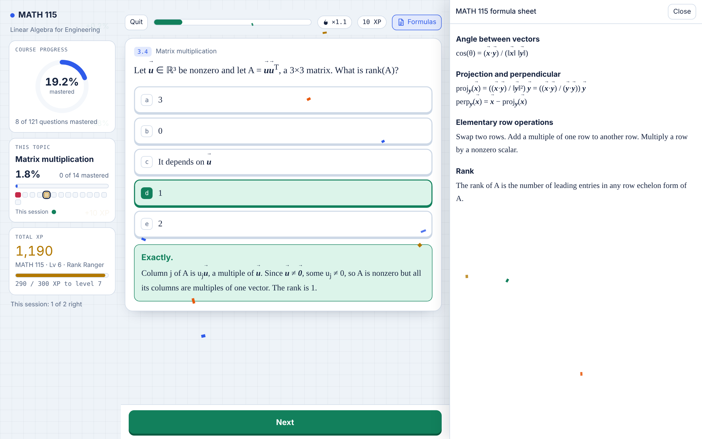
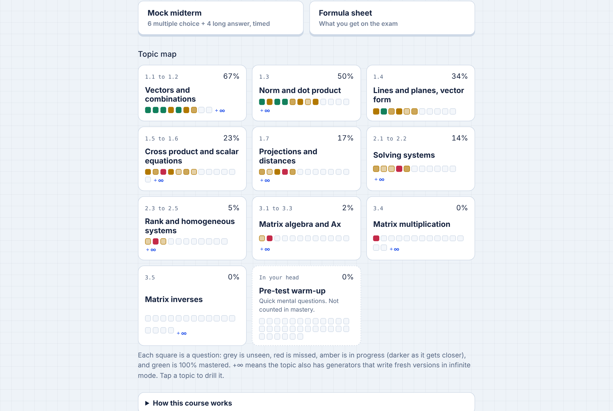
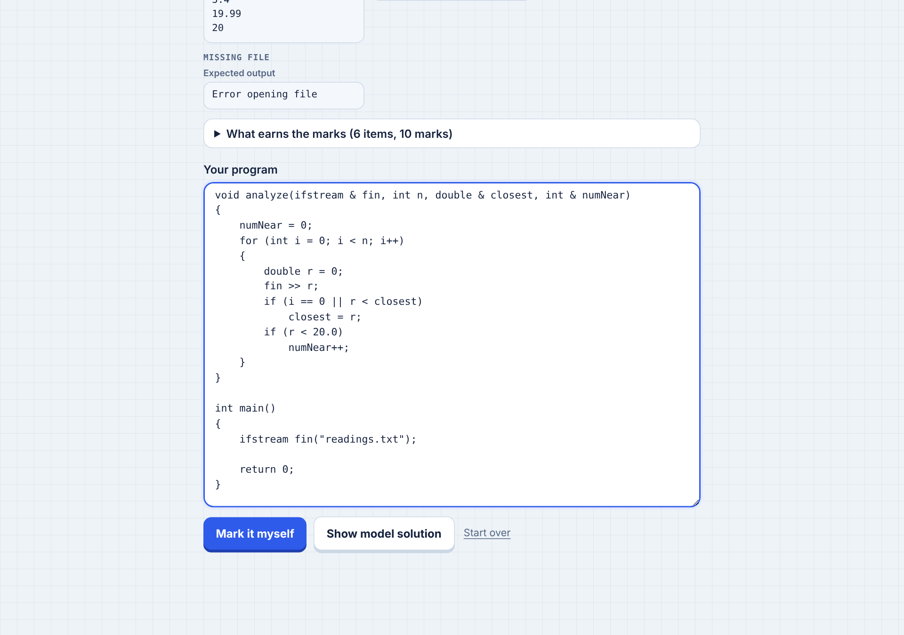
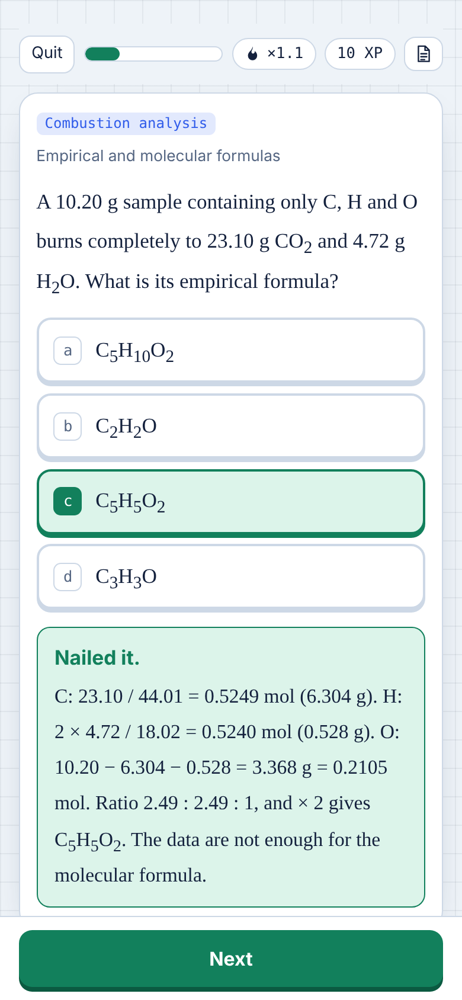

# Midterm Gym

A study app I built for my first-term Mechatronics Engineering midterms at the University of Waterloo. It's designed around one rule: **the AI helps me practise, but it doesn't do the thinking for me.**

**Try it: [alfietaba.github.io/Midterm-Gym](https://alfietaba.github.io/Midterm-Gym/)**. It runs in any browser, on a phone or a laptop, and saves your progress on your own device.



## Why I built it

I had five midterms in about a week (linear algebra, calculus, chemistry, C++ and a design course). The easy way to use AI for that is to paste in a problem and read the answer. It feels productive, but you end up recognising solutions instead of producing them, and that falls apart in an exam hall.

So I built the opposite: a tool that makes me attempt every question first, tells me exactly why I was wrong, and keeps bringing back whatever I haven't mastered.

## How it teaches

- **Answer first, then see why.** Every question has a full explanation, but it only appears after you commit to an answer. Hints are there if you're stuck, and using one halves your XP for that question.
- **Mastery means four in a row.** Questions move through a spaced-repetition schedule (8 hours, 1 day, 2 days, 4 days). A question only turns green after four correct answers in a row, and one miss sends it back to red.
- **Misses come back in the same session,** a few questions later, then again on the schedule.
- **You can't game the multiple choice.** I noticed the right answer was often just the longest option, so every option set was rewritten and checked by a script. Across the 324 multiple-choice questions with three or more options, the right answer is now the longest one 19% of the time, no better than guessing.
- **It only covers what's on the exam.** Anything that didn't fit a category on the course outline was removed.
- **Mock midterms have the same shape as the real ones:** the same sections, point weights and time limit. There's no feedback until you submit, then you get a breakdown by section and a "Fix my mistakes" run.
- **Fresh questions on demand.** 85 generators write new versions with new numbers, so infinite mode (endless, or three lives) never runs out.
- **The formula sheet sits beside the question,** like it does on the exam.
- **Real working, not just bubbles:**
  - numeric answers with significant-figure checking (the right value with the wrong sig figs earns half credit)
  - vectors and matrices
  - proofs built from tiles, including some wrong tiles
  - tracing C++ output
  - code puzzles with decoy lines
- **Write the code.** Full C++ programs marked against a 10-mark rubric:
  - Opened inside Claude, the page has Claude mark your program like a TA would: does it compile, what does it print on each test, where does it lose marks, and what to fix first. It never writes the code for you.
  - On GitHub Pages, you mark it yourself against the rubric, with the model solution beside it.
- **Focus tools:**
  - a study-timer candle that burns down while you work
  - a progress panel that animates course mastery, topic mastery and XP after every answer
  - a five-minute warm-up of questions you can do in your head before an exam

| Course page | Write the code | On a phone |
| --- | --- | --- |
|  |  |  |

## How I used AI

I used Claude (Anthropic) as a pair programmer and question writer. I decided what the tool needed to do and why: most of the rules above came from noticing, while studying, what wasn't working. Claude wrote most of the code and drafted questions from my course materials under that direction.

AI-written answers can be wrong, so nothing ships unchecked:

- **Every stored answer is regraded** by the app's own grader (619 questions).
- **Generated math is checked** against an independent solver (6,800 checks), and the generators are sampled 25,500 times for broken or ungradable output.
- **Every C++ question is compiled with g++ and run.** Code puzzles are compile-checked, VEX robot code is checked against a mock of the VEX API, and the write-the-code model solutions are run against their test files, including a missing file and an empty file.
- **Browser tests** (Playwright) drive the real interface at desktop and phone sizes.

GitHub Actions runs the non-browser checks on every push.

## What's inside

| Course | Topics | Questions | Generators |
| --- | --- | --- | --- |
| MATH 115 Linear Algebra | vectors to matrix inverses, plus a warm-up set | 151 | 10 |
| MTE 121 Digital Computation (C++) | fundamentals, decisions, loops and files, functions, VEX IQ robots | 116, plus 4 full programs | 23 |
| CHE 102 Chemistry for Engineers | stoichiometry, gases, kinetic theory, real gases | 112 | 24 |
| MATH 116 Calculus 1 | functions to derivatives | 136 | 19 |
| MTE 100 Mechatronics Concepts | engineering design, ethics, drawings and dimensioning | 104 | 9 |

## Tech

- **One self-contained HTML file:** vanilla JavaScript, CSS and inline SVG diagrams. No framework, no server and no dependencies at run time. Progress is stored in the browser's localStorage.
- `build/build.py` stitches `template.html`, the helpers, the course data and the app together into `docs/index.html`, which GitHub Pages serves.

```
build/     template.html, app.js (the app), helpers.js, gens.js (question generators), build.py
data/      one file per course: topics, questions, explanations, mock layout, formula sheet
tools/     checks, the g++ verifier, browser tests, screenshot script
docs/      the published page and screenshots
skill/     SKILL.md: the learning-first study method as a skill any AI assistant can use
```

## Build and test

```bash
python3 build/build.py                         # writes docs/index.html and out/test.html
node tools/check_keys.js                       # every stored answer grades as correct
node tools/check_gens.js                       # generators make valid, gradable problems
node tools/check_math.js                       # generated math matches an independent solver
node tools/verify_mte121.js data/mte121.js     # compiles and runs every C++ question (needs g++)

pip install playwright && playwright install chromium
python3 tools/e2e.py && python3 tools/code_test.py && python3 tools/side_test.py && python3 tools/inf_test.py
python3 tools/screenshots.py                   # regenerates docs/screenshots
```

## Use the method yourself

[`skill/SKILL.md`](skill/SKILL.md) turns the approach behind this app into instructions an AI assistant can follow: practice before answers, spaced mastery, exam-shaped mocks, verified answers, and reference sheets that teach. Point Claude, or any assistant that reads skills or long instructions, at that file along with your own course outline and notes.

## About the content

The practice questions are written in the style of each course; they aren't copied from it. This public version leaves out anything taken from course assessments (tutorial problems and course quiz questions), and it replaces the official exam data sheets with typed reference sheets. It isn't affiliated with or endorsed by the University of Waterloo.

MIT licensed.
